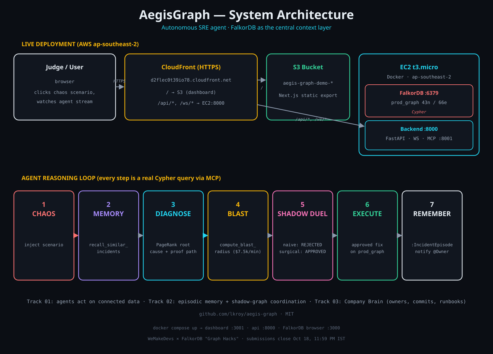

# AegisGraph — Autonomous SRE & Chaos Remediation Agent

**FalkorDB "Graph Hacks: Context for AI Agents" hackathon submission.**
Track 01 (Agents That Act on Connected Data) · Track 02 (Agent Memory & Coordination) · Track 03 (Company Brain)

## The problem

When a production incident fires, on-call engineers stare at dashboards and guess. They lose the thread across services, deploys, and owners; remediation is a leap of faith — nobody can prove a fix won't make things worse before applying it.

## What AegisGraph does

AegisGraph is an autonomous SRE command center. A 43-node enterprise e-commerce topology lives in **FalkorDB** (`prod_graph`): business flows, microservices, databases, commits, engineers, runbooks. You inject deterministic chaos (poison-pill commit, Redis pool exhaustion, payment gateway crash), the failure cascades multi-hop across the graph — and then the agent takes over:

1. **Episodic memory check** — recalls past `:IncidentEpisode` nodes from FalkorDB matching the failure signature (Track 02).
2. **Root-cause localization** — calls `localize_root_cause` over MCP: real `CALL algo.pageRank('Service','CALLS')` plus deepest-fault-boundary traversal isolates the single culprit service, its active commit, and the engineer who authored it (Track 01 + 03).
3. **Blast-radius calculation** — multi-hop `[:CALLS*1..6]` traversal maps impacted `:BusinessFlow` SLAs and extracts the ordered `causal_proof_path` (Track 01).
4. **Shadow-graph duel** — the hero feature. The agent clones `prod_graph` into isolated FalkorDB shadow graphs (`sim_rejected`, `sim_approved`) via the multigraph topology, applies a naive fix in one and a surgical fix in the other, and runs SLA reachability Cypher in each. The naive fix orphans revenue-generating flows → **REJECTED BY GRAPH**. The surgical fix proves $0 impact → **APPROVED BY GRAPH** (Track 01).
5. **Verified execution** — the approved fix is applied to production, the topology heals, an `:IncidentEpisode` is persisted to FalkorDB memory, and the owning engineer is notified with the proof path (Track 02 + 03).

## Why the graph is not decoration

Remove FalkorDB and nothing works: localization is a PageRank procedure call, blast radius is a variable-length traversal, the shadow duel is multigraph cloning + reachability queries, memory is persistent `:IncidentEpisode` nodes, and ownership is engineer/commit/runbook edges. Every agent action carries the exact ordered node/edge path it traversed, animated on the canvas.

## Graph data model

`prod_graph` holds 43 nodes / 66 edges across these labels and relationships (seeded deterministically by `backend/graph/seed_topology.py`):

**Nodes**

| Label | Represents | Properties |
|---|---|---|
| `BusinessFlow` | Revenue-generating flows (e.g. Global Web Checkout) | id, name, revenue_per_min, status |
| `Service` | Microservices across 4 tiers | id, name, tier, status, error_rate, latency_ms |
| `Database` | Postgres, Redis, CockroachDB, vault stores | id, name, engine, active_conns, max_conns, status |
| `Commit` | Deployed commits | id, hash, message, timestamp, is_active, is_buggy |
| `Engineer` | Service owners | id, handle, name, team, role |
| `Runbook` | Remediation runbooks | id, title, action_code, doc_url |
| `IncidentEpisode` | Past incidents, persisted by the agent at runtime | id, scenario_key, root_cause_node, approved_action, rejected_action, causal_path_json, resolved_at |

**Relationships**

| Type | From → To | Meaning | Properties |
|---|---|---|---|
| `DEPENDS_ON` | BusinessFlow → Service | flow entry point | critical |
| `CALLS` | Service → Service | RPC path | weight, route_type (PRIMARY / FALLBACK) |
| `READS_WRITES` | Service → Database | data access | conn_weight |
| `DEPENDS_ON` | Service → Service | service dependency | critical |
| `DEPLOYED_TO` | Commit → Service | deployed commit | — |
| `AUTHORED` | Engineer → Commit | authorship | — |
| `OWNS_SERVICE` | Engineer → Service | ownership | — |
| `GOVERNS` | Runbook → Service | remediation procedure | — |
| `RESOLVED_TARGET` | IncidentEpisode → Service | what was fixed | — |

Shadow graphs `sim_rejected` / `sim_approved` are FalkorDB multigraph clones of `prod_graph`, used for the fix duel.

## Architecture



```
┌─────────────┐      ┌──────────────────┐      ┌─────────────────┐
│  Next.js UI │◄────►│  FastAPI backend │◄────►│    FalkorDB     │
│  :3001      │ WS   │  :8000           │Cypher│ :6379 (graphs:  │
└─────────────┘      │  ┌────────────┐  │      │  prod_graph,    │
                     │  │ Agent loop │──┼──MCP─┤  sim_rejected,  │
                     │  └────────────┘  │ SSE  │  sim_approved)  │
                     │  ┌────────────┐  │      └─────────────────┘
                     │  │ FastMCP    │──┘
                     │  │ :8001 (7 tools)│
                     │  └────────────┘  │
                     └──────────────────┘
```

MCP tools (all real Cypher): `localize_root_cause`, `compute_blast_radius`, `detect_shared_bottleneck`, `discover_failover_route`, `simulate_candidate_action`, `recall_similar_incidents`, `list_graphs`.

## Run it

```bash
docker compose up --build
```

- Dashboard: http://localhost:3001
- API: http://localhost:8000 · FalkorDB Browser: http://localhost:3000

The backend auto-seeds `prod_graph` on first start. Click a chaos scenario, then **Run Autonomous FalkorDB Agent**, and switch the tenant pills to inspect `sim_rejected` vs `sim_approved`.

### Manual backend (no Docker)

```bash
# 1. Start FalkorDB however you like, e.g.:
docker run -p 6379:6379 -p 3000:3000 falkordb/falkordb:latest
# 2. Backend
cd backend && python -m venv .venv && .venv/bin/pip install -r requirements.txt
.venv/bin/python main.py
# 3. Frontend
cd frontend && npm install && npm run dev   # -> http://localhost:3000
```

## Project layout

```
backend/
  main.py                 # FastAPI REST + WebSocket
  graph/client.py         # FalkorDB connection & multigraph helpers
  graph/seed_topology.py  # 43 nodes / 66 edges deterministic seed
  graph/chaos_engine.py   # 3 deterministic chaos injectors
  graph/cypher_queries.py # all Cypher + algo calls
  graph/shadow_simulator.py # multigraph clone + SLA verification
  mcp_server/server.py    # FastMCP server (7 tools)
  mcp_server/client.py    # MCP ClientSession (SSE) used by the agent
  agent/orchestrator.py   # deterministic remediation loop
frontend/                 # Next.js 14 SRE command center
```

## Pre-existing vs built-during-event

Built during the event: the entire AegisGraph codebase — graph data model, all Cypher queries, the shadow simulator, MCP tools, agent loop, and UI. Reused: open-source libraries (FalkorDB, FastAPI, FastMCP, Next.js, react-force-graph-2d).

Disclosure: AI coding assistants were used during the build; every behavior shown in the demo was verified end-to-end against live FalkorDB.

## License

MIT
